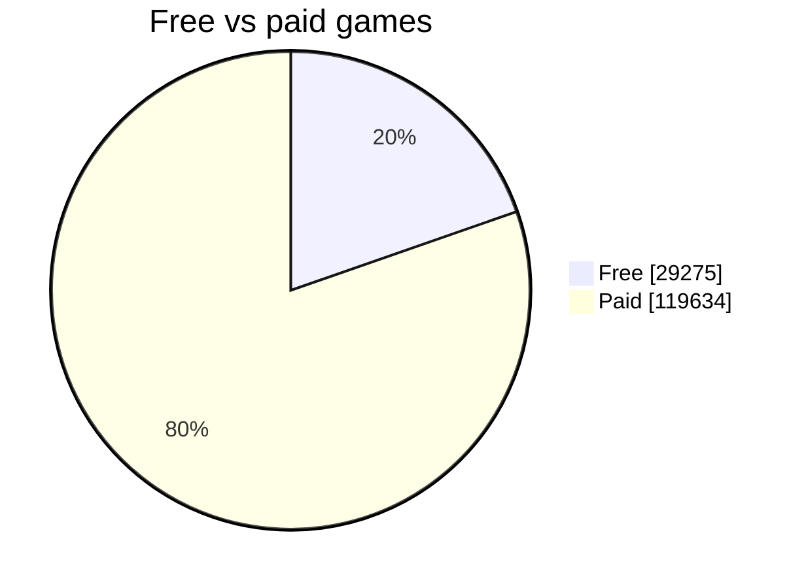

# Steam-games-data-pipeline: data snapshot

Generated 2026-11-20 from the `core` model (Steam-games-data-pipeline 0.8.0). Interactive charts: [index.html](index.html), opened from a local clone or GitHub Pages. Refresh with `python main.py dashboard`.

## Headline numbers

|  |  |
| --- | ---: |
| Games | 148,909 |
| Developers | 92,522 |
| Tags | 452 |
| Genres | 33 |
| Languages | 107 |
| Reviews | 148,914,706 |
| Releases | 1997-06-30 to 2026-11-08 |

## Data quality

**✅ OK**: 14 of 14 constraints valid; checks: 18 passed, 11 warnings, 0 failed, 0 could not run, 0 skipped.

Every check

| Status | Severity | Rows | Check | About |
| --- | --- | ---: | --- | --- |
| ✅ pass | error | 0 | landing_and_core_row_counts_match | core.games must have exactly as many rows as the JSON landing table |
| ✅ pass | error | 0 | games_with_tags_all_linked | a game whose JSON tags object is not empty must have rows in core.game_tags |
| ✅ pass | error | 0 | games_with_developers_all_linked | a game with a non-empty JSON developers list must have rows in core.game_developers |
| ✅ pass | warn | 0 | csv_games_missing_from_json | games in the CSV snapshot that the JSON snapshot does not contain |
| ✅ pass | warn | 0 | names_lost_by_csv_reader | name is NULL in the CSV load although the JSON has one (a CSV reading problem) |
| ⚠️ warn | warn | 1 | game_name_missing | games without a name (a warning, not a constraint: the source has one such game) |
| ✅ pass | warn | 0 | release_date_not_parsed | release date text in none of the formats 'Mon DD, YYYY', 'DD Mon, YYYY', 'Mon YYYY' |
| ✅ pass | warn | 0 | owner_bucket_not_parsed | estimated_owners text that is not a 'low - high' range |
| ⚠️ warn | warn | 8,457 | game_without_developer | games with no developer |
| ⚠️ warn | warn | 8,437 | game_without_genre | games with no genre |
| ⚠️ warn | warn | 65,519 | game_without_tags | games with no user tags (tags only appear once enough players vote) |
| ✅ pass | warn | 0 | tag_votes_missing | tags without a vote count (the source gave a list of names instead of votes) |
| ⚠️ warn | warn | 8,402 | game_without_language | games with no supported language |
| ✅ pass | error | 0 | price_negative | prices below zero |
| ✅ pass | error | 0 | discount_out_of_range | discounts outside 0-100 percent (a sign of shifted columns) |
| ✅ pass | error | 0 | owner_range_reversed | owner buckets whose lower edge is above the upper edge |
| ✅ pass | error | 0 | review_counts_negative | negative review or recommendation counts |
| ✅ pass | error | 0 | metacritic_out_of_range | Metacritic scores outside 1-100 |
| ✅ pass | warn | 0 | required_age_out_of_range | age ratings outside 0-21 |
| ⚠️ warn | warn | 1 | release_date_in_future | release dates after today (unreleased games, or a wrong date) |
| ⚠️ warn | warn | 9 | no_platform | games flagged for none of Windows, Mac, Linux (a warning, not a constraint: the source has 9) |
| ⚠️ warn | warn | 39 | free_game_with_discount | price is 0 but a discount is set |
| ✅ pass | warn | 0 | two_week_playtime_too_long | average playtime in the last two weeks above 20160 minutes, which is two full weeks |
| ✅ pass | warn | 0 | reviews_but_zero_owner_bucket | games with reviews whose owner estimate is the '0 - 0' bucket (owner counts are estimates) |
| ⚠️ warn | warn | 11 | more_reviews_than_max_owners | more reviews than the upper edge of the owner estimate allows |
| ✅ pass | warn | 0 | tag_names_differ_only_by_case | tags that are the same word in different capitalisation |
| ✅ pass | warn | 0 | developer_names_differ_only_by_case | developers that are the same name in different capitalisation (the model merges them) |
| ⚠️ warn | warn | 1 | developer_name_is_company_suffix | developer names that are only a company suffix, such as 'LIMITED' |
| ⚠️ warn | warn | 2 | language_name_suspicious | language names that still contain markup, digits or are very long |

## Free and paid games

## Price bands

| Price | Games |  |
| --- | ---: | --- |
| Free | 29,275 | █████████ |
| Under $5 | 77,296 | ████████████████████████ |
| $5-10 | 26,556 | ████████ |
| $10-20 | 12,628 | ████ |
| $20-40 | 2,247 | █ |
| $40-60 | 450 | █ |
| $60 and more | 457 | █ |

## Releases per year

The last year, 2026, is partial: the data is a snapshot.

| Year | Games |  |
| --- | ---: | --- |
| 1997 | 2 | █ |
| 1998 | 1 | █ |
| 1999 | 2 | █ |
| 2000 | 2 | █ |
| 2001 | 4 | █ |
| 2002 | 1 | █ |
| 2003 | 3 | █ |
| 2004 | 6 | █ |
| 2005 | 7 | █ |
| 2006 | 69 | █ |
| 2007 | 90 | █ |
| 2008 | 158 | █ |
| 2009 | 321 | █ |
| 2010 | 255 | █ |
| 2011 | 260 | █ |
| 2012 | 322 | █ |
| 2013 | 468 | █ |
| 2014 | 1,524 | █ |
| 2015 | 2,518 | ██ |
| 2016 | 4,143 | ████ |
| 2017 | 5,927 | █████ |
| 2018 | 7,461 | ███████ |
| 2019 | 7,246 | ███████ |
| 2020 | 8,811 | ████████ |
| 2021 | 11,074 | ██████████ |
| 2022 | 12,293 | ███████████ |
| 2023 | 14,607 | █████████████ |
| 2024 | 20,045 | ██████████████████ |
| 2025 | 24,977 | ███████████████████████ |
| 2026 | 26,311 | ████████████████████████ |

## Platforms

A game can run on several platforms, so the shares add up to more than 100 %.

| Platform | Games | Share |
| --- | ---: | ---: |
| Windows | 148,842 | 99.9 % |
| Mac | 25,228 | 16.9 % |
| Linux | 19,198 | 12.9 % |

## Top tags by votes

| Tag | Votes |  | Games |
| --- | ---: | --- | ---: |
| Action | 5,162,925 | ████████████████████████ | 36,831 |
| Adventure | 4,570,407 | █████████████████████ | 35,216 |
| Singleplayer | 4,457,094 | █████████████████████ | 50,376 |
| Casual | 3,901,867 | ██████████████████ | 36,575 |
| Indie | 3,258,727 | ███████████████ | 48,575 |
| 2D | 3,031,012 | ██████████████ | 26,801 |
| Strategy | 2,575,737 | ████████████ | 17,863 |
| RPG | 2,543,409 | ████████████ | 15,756 |
| Simulation | 2,496,403 | ████████████ | 17,902 |
| 3D | 2,383,738 | ███████████ | 18,005 |
| Exploration | 2,377,246 | ███████████ | 13,245 |
| Atmospheric | 2,217,890 | ██████████ | 16,290 |
| Puzzle | 1,986,207 | █████████ | 16,376 |
| Multiplayer | 1,960,371 | █████████ | 10,155 |
| Story Rich | 1,947,436 | █████████ | 13,351 |

## Top genres

| Genre | Games |  |
| --- | ---: | --- |
| Indie | 99,608 | ████████████████████████ |
| Casual | 63,109 | ███████████████ |
| Action | 54,828 | █████████████ |
| Adventure | 53,367 | █████████████ |
| Simulation | 31,243 | ████████ |
| Strategy | 28,688 | ███████ |
| RPG | 25,479 | ██████ |
| Free To Play | 15,181 | ████ |
| Early Access | 14,951 | ████ |
| Sports | 5,768 | █ |
| Racing | 4,726 | █ |
| Massively Multiplayer | 3,026 | █ |
| Utilities | 1,124 | █ |
| Design & Illustration | 596 | █ |
| Animation & Modeling | 494 | █ |

## Top languages

| Language | Games |  | Full audio |
| --- | ---: | --- | ---: |
| English | 134,132 | ████████████████████████ | 53,124 |
| Simplified Chinese | 44,795 | ████████ | 10,197 |
| Japanese | 39,244 | ███████ | 8,768 |
| German | 38,364 | ███████ | 7,103 |
| French | 38,237 | ███████ | 6,726 |
| Spanish - Spain | 35,971 | ██████ | 6,721 |
| Russian | 35,696 | ██████ | 7,895 |
| Korean | 26,981 | █████ | 5,327 |
| Italian | 26,368 | █████ | 4,615 |
| Portuguese - Brazil | 24,310 | ████ | 5,049 |
| Traditional Chinese | 23,505 | ████ | 5,855 |
| Polish | 17,883 | ███ | 3,685 |
| Turkish | 15,296 | ███ | 3,983 |
| Portuguese - Portugal | 14,501 | ███ | 3,347 |
| Spanish - Latin America | 13,339 | ██ | 3,978 |

## Review concentration

Reviews pile up on a few hits, so statistics weighted by reviews mostly describe blockbusters.

| Top games | Share of all reviews |
| --- | ---: |
| 1 % | 82.39 % |
| 5 % | 95.82 % |
| 10 % | 98.29 % |
| 25 % | 99.69 % |
| 50 % | 99.99 % |

